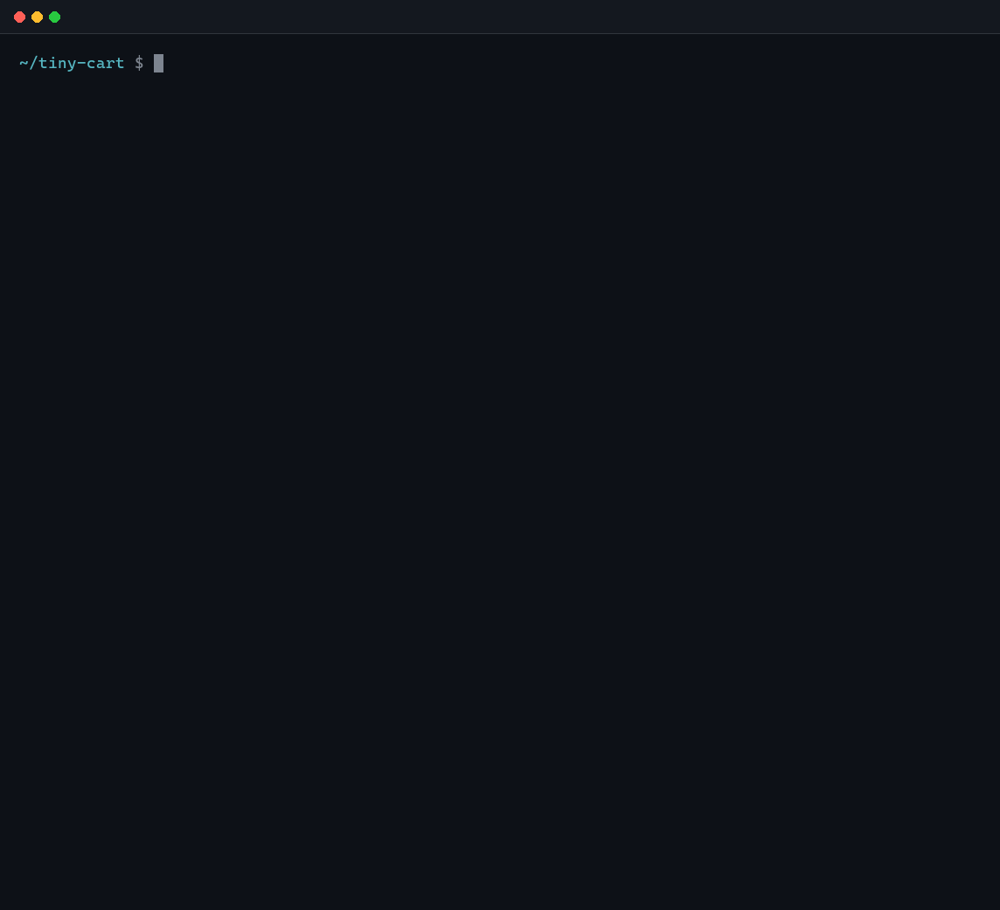

# whobrokeit

**Find the commit that broke it, and prove it.**

English · [Türkçe](README.tr.md)

Describe a bug in one sentence. An AI agent writes a test that shows it, whobrokeit walks your git history to the first commit where that test fails, and proves the result: the test fails at that commit and passes at its parent. Then it explains what went wrong and suggests a fix, which it shows only after the test passes with it.

<p align="center">
  
</p>

```sh
npx whobrokeit demo        # try it on a generated repo with a hidden bug (no AI needed)
npx whobrokeit demo --ai   # the same, with an AI agent writing the test
```

## Use it

Describe the bug, from anywhere inside your repo:

```sh
whobrokeit "Adding 3 mugs costs the same as 1 mug."
```

This needs [Claude Code](https://github.com/anthropics/claude-code) or [Codex](https://github.com/openai/codex) installed and logged in. whobrokeit uses whichever it finds.

Or bring your own failing test, and no AI is involved:

```sh
whobrokeit --test "npm test -- cart.test.js"
whobrokeit --test "pytest tests/test_cart.py -x"
whobrokeit --test "node repro.mjs" --with repro.mjs   # a test you haven't committed yet
```

Any command works. Exit code 0 means it works, 125 means this commit can't be tested (skip it), anything else means broken. Add `--explain` to get the explanation and a fix in this mode too.

## What it does

1. **Reproduce.** The agent reads your code and writes a small script that prints a `WHOBROKEIT_BUG:` line when it sees the bug. whobrokeit runs it at `HEAD` and only goes on if it fails there for that reason. A crash without that line counts as "can't tell", so a test that calls a function older commits don't have never blames the wrong commit.
2. **Find a commit where it still worked.** It walks back 1, 2, 4, 8… commits until the test passes. Or pass `--good <ref>`.
3. **Bisect.** `git bisect` narrows it down to the first bad commit, skipping commits the test can't tell about.
4. **Prove it.** It runs the test again at the culprit (fails) and at its parent (passes).
5. **Explain and fix.** The agent says why the change broke things and proposes an edit. whobrokeit applies it, runs the test, and shows the fix only if the test passes. It saves it as a patch you can `git apply`.

## Tested on real bugs

I ran it on 12 closed regression issues from commander, semver, postcss, luxon, marked, express, markdown-it, fastify and yargs. It got only the issue text, exactly as the reporter wrote it. It proved the commit the maintainers had identified in **11 of 12** cases, in about 100 seconds each. The cases, the one miss and how to rerun everything are in [bench/](bench).

## Safe to run on your repo

- **Your working copy is never touched.** Every check runs in a temporary `git worktree`, which is removed at the end. Uncommitted changes, open files and your current branch stay as they are.
- **The agent can only read.** Claude Code runs with the Read, Grep and Glob tools only, and with your hooks, plugins and MCP servers turned off. Codex runs in its read-only sandbox. whobrokeit runs the test the agent writes, so check it if you don't trust the repo.
- **Nothing is taken on faith.** The test has to fail at `HEAD` for the reported reason, the culprit has to be proven against its parent, and a fix has to make the test pass.
- **Dependencies are installed per commit** when `package.json` or a lockfile changes (npm, pnpm, yarn, bun). Use `--setup "<cmd>"` for anything else, or `--no-setup`.

## Options

| Option | |
|---|---|
| `-t, --test <cmd>` | A command that fails while the bug is present. |
| `--agent <name>` | Who writes the test: `claude`, `codex`, or any command that reads a prompt on stdin and answers on stdout. Default: `claude`, else `codex`. |
| `--model <name>` | Model for the agent, e.g. `sonnet`. |
| `--explain` / `--no-explain` | Explain the culprit and test a fix. On by default when you describe a bug, off with `--test`. |
| `-w, --with <file>` | Copy this file from your working copy into every commit tested. Repeatable. |
| `-g, --good <ref>` | A commit where it still worked. Default: found automatically. |
| `-b, --bad <ref>` | A commit where it is broken. Default: `HEAD`. |
| `--setup <cmd>` / `--no-setup` | Install command, re-run when dependency files change. Default: auto. |
| `--timeout <sec>` | Time limit for each test run. Default: 600, or 300 for agent-written tests. |
| `--report <file>` | Also write a Markdown report, ready to paste into an issue or PR. |
| `--json` | Print the result as JSON. |

Exit codes: `0` found and proven · `1` error · `2` bug not reproduced · `3` no working commit found · `4` inconclusive.

## Good to know

- Requires Node.js 20+ and git. No other dependencies.
- The test can be in any language your project uses. Automatic dependency install covers JavaScript package managers; for other stacks, use `--setup`.
- With an agent, a run usually makes two requests: one to write the test, one to explain the culprit (each is retried once if its result doesn't hold up). On the demo repo the whole run takes 30 to 60 seconds.
- If the project commits no lockfile, old commits get today's versions of their dependencies. A bug that depends on a dependency's version can then be traced to the wrong commit.
- After a run, the agent's test and the fix are in `.git/whobrokeit/`, outside your working tree.

## License

[MIT](LICENSE)
