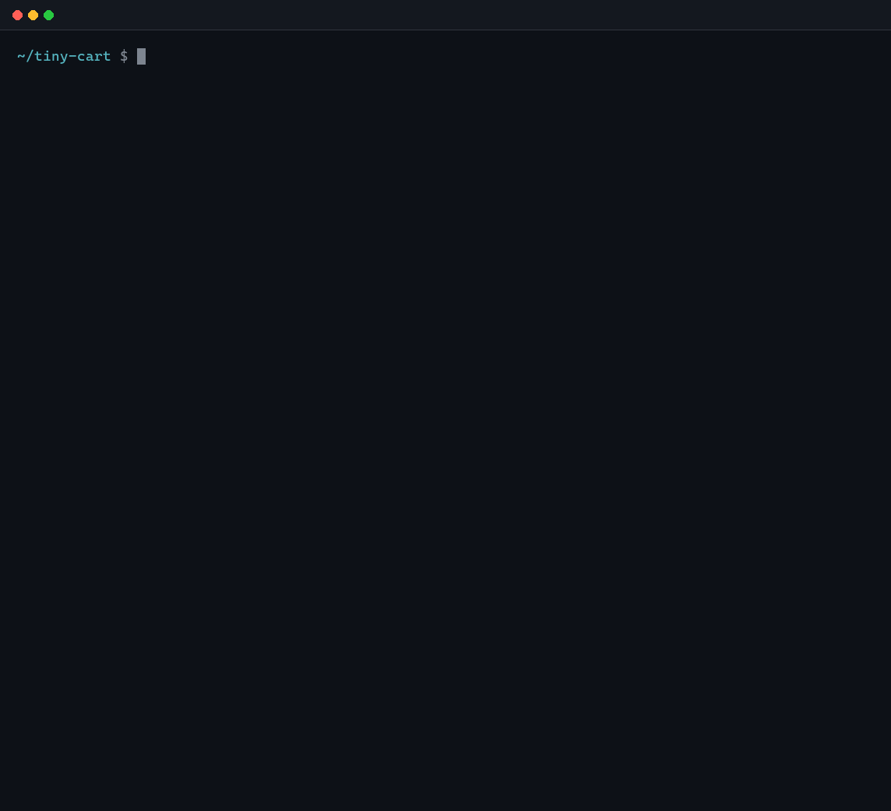

# whobrokeit

**Hatayı getiren commit'i bulur ve kanıtlar.**

[](https://www.npmjs.com/package/whobrokeit) [](https://github.com/BerkanAtik/whobrokeit/actions/workflows/ci.yml) [](https://github.com/marketplace/actions/whobrokeit-bisect) [](https://github.com/BerkanAtik/whobrokeit/blob/main/LICENSE)

[English](README.md) · Türkçe

Hatayı tek cümleyle anlatırsın. Bir yapay zekâ ajanı hatayı gösteren bir test yazar; whobrokeit git geçmişinde bu testin ilk başarısız olduğu commit'e kadar gider ve sonucu kanıtlar: test o commit'te başarısız, bir öncekinde başarılıdır. Ardından neyin bozulduğunu açıklar ve bir düzeltme önerir. Düzeltmeyi ancak test onunla geçtikten sonra gösterir.

<p align="center">
  
</p>

```sh
npx whobrokeit demo        # içine hata gizlenmiş örnek bir repoda dene (yapay zekâ gerekmez)
npx whobrokeit demo --ai   # aynısı, testi yapay zekâ ajanı yazar
```

## Kullanım

Reponun içindeyken hatayı anlat:

```sh
whobrokeit "Sepete 3 kupa ekleyince fiyat 1 kupa kadar çıkıyor."
```

Bunun için [Claude Code](https://github.com/anthropics/claude-code) ya da [Codex](https://github.com/openai/codex) kurulu ve giriş yapılmış olmalı. whobrokeit hangisini bulursa onu kullanır. Açıklama, hatayı hangi dilde yazdıysan o dilde gelir.

Ya da başarısız olan testi kendin ver, o zaman yapay zekâ hiç devreye girmez:

```sh
whobrokeit --test "npm test -- cart.test.js"
whobrokeit --test "pytest tests/test_cart.py -x"
whobrokeit --test "node repro.mjs" --with repro.mjs   # henüz commit'lemediğin bir test
```

Her komut olur. Çıkış kodu 0 çalışıyor, 125 bu commit test edilemiyor (atla), diğer her şey bozuk demektir. Bu modda da açıklama ve düzeltme istersen `--explain` ekle.

## GitHub issue'larında

whobrokeit bir GitHub Action olarak da çalışır. Bir issue'ya `whobrokeit` etiketini koyduğunda ya da `/whobrokeit` yorumunu yazdığında hatayı getiren commit'i arar. Sonra issue'ya bir yorum yazar: suçlu commit, kanıtı ve test edilmiş bir düzeltme.

Repoya `ANTHROPIC_API_KEY` adında bir secret ekle, sonra şunu `.github/workflows/whobrokeit.yml` olarak kaydet:

```yaml
name: whobrokeit

on:
  issues:
    types: [labeled]
  issue_comment:
    types: [created]

permissions:
  contents: read
  issues: write

jobs:
  whobrokeit:
    # Yalnız issue etiketleyebilenler ya da /whobrokeit yazan üyeler ve katkıcılar.
    if: >-
      (github.event_name == 'issues' && github.event.label.name == 'whobrokeit') ||
      (github.event_name == 'issue_comment' && !github.event.issue.pull_request &&
       startsWith(github.event.comment.body, '/whobrokeit') &&
       contains(fromJSON('["OWNER", "MEMBER", "COLLABORATOR"]'), github.event.comment.author_association))
    runs-on: ubuntu-latest
    timeout-minutes: 60
    steps:
      - uses: actions/checkout@v7
        with:
          fetch-depth: 0               # whobrokeit geçmişe ihtiyaç duyar
          persist-credentials: false
      - uses: actions/setup-node@v7
        with:
          node-version: 22             # en az 22, Claude Code bunu istiyor
          package-manager-cache: false # issue'dan yazılan testler önbelleğe ulaşmasın
      - uses: BerkanAtik/whobrokeit@v0
        with:
          anthropic-api-key: ${{ secrets.ANTHROPIC_API_KEY }}
```

Varsayılan olarak issue'nun başlığı ve metniyle çalışır. `/whobrokeit`'ten sonra bir metin yazarsan onların yerine o kullanılır. Böylece hatayı daha net anlatabilirsin: `/whobrokeit Sepete 3 kupa ekleyince fiyat 1 kupa kadar çıkıyor.`

| Girdi | |
|---|---|
| `anthropic-api-key` | Anthropic API anahtarı. Claude aboneliğini kullanmak için onun yerine `claude setup-token` ile alınan `claude-code-oauth-token`. |
| `bug` | Bozuk olan şey. Varsayılan: yorumda `/whobrokeit`'ten sonraki metin, o da yoksa issue. |
| `test` | Başarısız olan kendi test komutun. O zaman testi yapay zekâ yazmaz. |
| `explain` | `auto` (varsayılan), `true` ya da `false`. |
| `agent`, `model`, `good`, `bad`, `setup`, `timeout` | Komut satırındakiyle aynı. `setup: none` kurulumu kapatır. |
| `working-directory` | Aranacak repo, çalışma alanının kökü değilse. |
| `comment` | Issue'ya yorum yazmasın istersen `false`. Rapor her durumda job özetinde de olur. |

Çıktılar: `exit-code`, `commit` (suçlu commit'in kısa hash'i) ve `report` (Markdown raporun yolu). Job yalnız bir hata olursa başarısız olur. Yeniden üretilemeyen bir hata da diğer sonuçlar gibi issue'ya yazılır.

Bir issue'da çalıştırmadan önce issue'yu oku. Ajan yalnız kodu okur, ama yazdığı testi whobrokeit çalıştırır, ve issue metni ajanı yönlendirmeye çalışabilir. whobrokeit'in çalıştırdığı testlerin ortamında AI anahtarı da GitHub token'ı da olmaz; token da issue'ları değiştirebilir ama koduna dokunamaz. Yine de runner'daki kod aynı kullanıcıyla çalışır; harcama sınırı olan bir API anahtarı kullan.

## Ne yapar

1. **Hatayı yeniden üretir.** Ajan kodu okur ve hatayı görünce `WHOBROKEIT_BUG:` satırı basan küçük bir betik yazar. whobrokeit onu `HEAD`'de çalıştırır, yalnız bu sebeple başarısız olursa devam eder. Bu satır olmadan gelen bir çökme "belli değil" sayılır; eski commit'lerde olmayan bir fonksiyonu çağıran test yüzünden yanlış commit suçlanmaz.
2. **Hâlâ çalıştığı bir commit bulur.** Test geçene kadar 1, 2, 4, 8… commit geri gider. İstersen `--good <ref>` ile kendin verirsin.
3. **Bisect yapar.** `git bisect` ile ilk bozuk commit'e iner, testin karar veremediği commit'leri atlar.
4. **Kanıtlar.** Testi suçlu commit'te (başarısız) ve bir öncekinde (başarılı) yeniden çalıştırır.
5. **Açıklar ve düzeltir.** Ajan değişikliğin neyi bozduğunu anlatır ve bir düzenleme önerir. whobrokeit düzenlemeyi uygular, testi çalıştırır, yalnız test geçerse gösterir. `git apply` ile uygulanabilen bir patch olarak da kaydeder.

## Gerçek hatalarda denendi

commander, semver, postcss, luxon, marked, express, markdown-it, fastify ve yargs projelerinden kapanmış 12 regresyon issue'sunda çalıştırdım. Araca yalnız issue metni verildi, raporu yazan kişinin yazdığı haliyle. **12 vakanın 11'inde** proje sahiplerinin belirlediği commit'i kanıtladı; her biri yaklaşık 100 saniye sürdü. Vakalar, tutmayan tek vaka ve hepsini yeniden çalıştırma adımları [bench/](bench) klasöründe.

## Reponda güvenle çalışır

- **Çalışma kopyana dokunmaz.** Her kontrol geçici bir `git worktree` içinde yapılır ve sonunda silinir. Commit'lenmemiş değişikliklerin, açık dosyaların ve bulunduğun branch olduğu gibi kalır.
- **Ajan yalnız okuyabilir.** Claude Code yalnız Read, Grep ve Glob araçlarıyla, hook'ların, eklentilerin ve MCP sunucuların kapalıyken çalışır. Codex kendi salt okunur sandbox'ında çalışır. Ajanın yazdığı testi whobrokeit çalıştırır; güvenmediğin bir repoda bu testi kontrol et.
- **Hiçbir şey sözle kabul edilmez.** Test `HEAD`'de bildirilen sebeple başarısız olmalı, suçlu commit bir öncekiyle karşılaştırılarak kanıtlanmalı, düzeltme de testi geçirmeli.
- **Bağımlılıklar commit başına kurulur:** `package.json` ya da lockfile değiştiğinde (npm, pnpm, yarn, bun). Başka bir şey için `--setup "<komut>"`, hiç kurmamak için `--no-setup`.

## Seçenekler

| Seçenek | |
|---|---|
| `-t, --test <cmd>` | Hata varken başarısız olan bir komut. |
| `--agent <name>` | Testi kim yazar: `claude`, `codex` ya da stdin'den talimat alıp stdout'a cevap yazan herhangi bir komut. Varsayılan: `claude`, yoksa `codex`. |
| `--model <name>` | Ajanın modeli, örn. `sonnet`. |
| `--explain` / `--no-explain` | Suçlu commit'i açıkla ve düzeltme dene. Hatayı anlattığında açık, `--test` ile kapalı. |
| `-w, --with <file>` | Bu dosyayı çalışma kopyandan test edilen her commit'e kopyala. Birden çok verilebilir. |
| `-g, --good <ref>` | Hâlâ çalıştığı bir commit. Varsayılan: otomatik bulunur. |
| `-b, --bad <ref>` | Bozuk olduğu bir commit. Varsayılan: `HEAD`. |
| `--setup <cmd>` / `--no-setup` | Kurulum komutu, bağımlılık dosyaları değişince yeniden çalışır. Varsayılan: otomatik. |
| `--timeout <sec>` | Her test çalıştırması için süre sınırı. Varsayılan: 600, ajanın yazdığı testlerde 300. |
| `--report <file>` | Ayrıca issue ya da PR'a yapıştırmaya hazır bir Markdown rapor yaz. |
| `--json` | Sonucu JSON olarak bas. |

Çıkış kodları: `0` bulundu ve kanıtlandı · `1` hata · `2` hata yeniden üretilemedi · `3` çalışan commit bulunamadı · `4` sonuçsuz.

## Bilmekte fayda var

- Node.js 20+ ve git gerekir. Başka bağımlılık yok.
- Test, projenin kullandığı herhangi bir dilde olabilir. Otomatik bağımlılık kurulumu JavaScript paket yöneticilerini kapsar; diğerleri için `--setup` kullan.
- Ajanla bir çalıştırma genelde iki istek yapar: biri testi yazmak, biri suçlu commit'i açıklamak için (sonuç tutmazsa her biri bir kez daha denenir). Demo reposunda tüm süreç 30–60 saniye sürer.
- Proje lockfile commit'lemiyorsa eski commit'ler bağımlılıklarının bugünkü sürümleriyle kurulur. Bir bağımlılığın sürümüne bağlı hatalarda yanlış commit bulunabilir.
- Bağımlılıklar değiştikçe yeniden kurulur, ama commit'ler arasında hiçbir şey yeniden derlenmez. Testin derlenmiş dosyalarla çalışıyorsa (örneğin `dist/`), derlemeyi komuta ekle: `--test "npm run build && npm test"`. Ajana da aynısı söylenir.
- İş bitince ajanın yazdığı test ve düzeltme `.git/whobrokeit/` içinde durur, çalışma klasörünün dışında.

## Lisans

[MIT](LICENSE)
